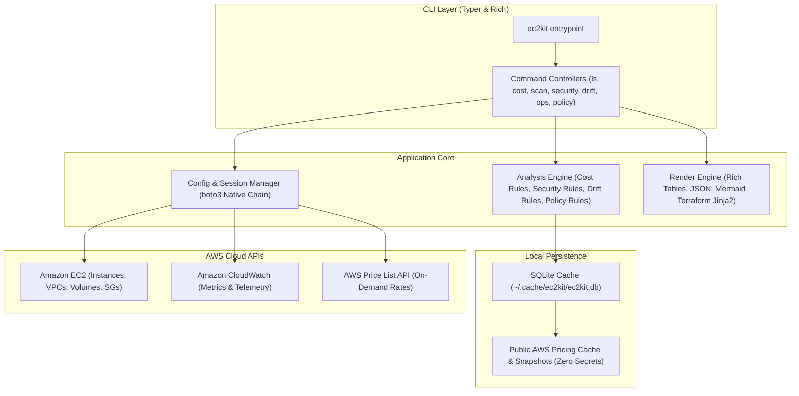

# ec2kit

[](https://www.python.org/downloads/)
[](LICENSE)
[](https://github.com/astral-sh/ruff)
[]()
[]()

**ec2kit** is a production-grade, developer-first command-line interface for discovering, analyzing, auditing, securing, and managing AWS EC2 infrastructure without relying on the AWS Management Console.

Built with Python 3.11+, Typer, Rich, and Boto3, `ec2kit` provides deep infrastructure insights, cost optimization intelligence, security posture auditing, automated Mermaid diagramming, Terraform export, and drift detection.

---

## Key Capabilities

- **Lightning-Fast Discovery (`ec2kit ls`)**: Multi-region, concurrent EC2 discovery with rich state color-coding, network details, and instant filtering.
- **Cost Intelligence (`ec2kit cost`)**: On-demand monthly run-rate estimation, multi-dimensional idle instance detection (CPU + Network), right-sizing recommendations, and orphaned resource identification (unattached EBS volumes, idle Elastic IPs).
- **VPC & Network Mapping (`ec2kit scan`)**: Discovers full network topologies (VPCs, Subnets, Route Tables, IGWs, NATs, Security Groups) and automatically renders Mermaid architecture flowcharts.
- **Security Posture Audit (`ec2kit security`)**: Scans for exposed ports (SSH 22, RDP 3389, databases), unrestricted ingress rules, unencrypted EBS storage, and vulnerable IMDSv1 configurations with exact remediation CLI commands.
- **Terraform HCL Export (`ec2kit export terraform`)**: Exports live cloud topologies into clean, reviewable Terraform 1.5+ HCL manifests (`main.tf`, `variables.tf`, `outputs.tf`) annotated with exact `terraform import` commands.
- **Terraform Drift Detection (`ec2kit drift`)**: Compares live AWS resources against local `terraform.tfstate` or `terraform show -json` files to pinpoint missing, unmanaged, or modified cloud resources.
- **Safe Lifecycle Operations (`ec2kit start / stop / reboot / terminate`)**: Safe instance mutations featuring pre-execution blast-radius impact analysis, native AWS `--dry-run` validation, and mandatory confirmation guardrails.
- **Declarative Policy Governance (`ec2kit policy check`)**: Evaluates infrastructure against custom YAML governance policies (required tags, approved instance families, quotas), returning exit code `0` for compliance and `1` for violations to power CI/CD gates.

---

## Core Engineering Principles

1. **Read-Only by Default**: All discovery, cost, security, scan, and drift commands are 100% read-only.
2. **Blast-Radius Awareness**: Mutating commands (`stop`, `terminate`, etc.) always display full operational consequences before taking action and support AWS native `--dry-run`.
3. **Zero Credential Persistence**: Credentials are never written to SQLite, logs, or disk. Standard AWS credential provider chains (SSO, IAM roles, profiles, environment variables) are used natively.
4. **Clean Unix Stream Separation**: Standard output (`stdout`) is strictly reserved for human-friendly tables or pure machine-readable JSON (`--json`). Diagnostics, progress spinners, and logs are routed exclusively to `stderr`.
5. **No Blind Assumptions**: Missing CloudWatch telemetry is flagged as insufficient evidence rather than assumed zero utilization; memory metrics are never hallucinated without CloudWatch Agent confirmation.
6. **No Terraform State Tampering**: `ec2kit` generates reviewable HCL and detects drift, but never touches `.tfstate` files or executes `terraform apply`.

---

## Architecture



---

## Quickstart

### Installation

```bash
# Clone the repository
git clone https://github.com/your-org/ec2kit.git
cd ec2kit

# Create a virtual environment and install dependencies
python3 -m venv .venv
source .venv/bin/activate
pip install -e ".[dev]"
```

### Basic Commands

```bash
# Verify installation and AWS identity
ec2kit info

# Discover instances across all AWS regions
ec2kit ls --all-regions

# Filter running t3 instances
ec2kit ls --state running --type t3.micro

# Cost & idle resource analysis over the past 14 days
ec2kit cost --days 14

# Generate and export VPC architecture diagram
ec2kit scan --output architecture.mmd

# Audit infrastructure security posture
ec2kit security --severity HIGH

# Export live VPC topology to Terraform HCL
ec2kit export terraform --output-dir ./terraform

# Detect drift between live AWS and your Terraform state
ec2kit drift --state terraform.tfstate

# Validate infrastructure against organizational governance policy
ec2kit policy check --policy policy.yaml

# Safely stop an instance with blast-radius preview and dry-run
ec2kit stop i-0123456789abcdef0 --dry-run
```

---

## Command Matrix & Usage Guide

| Command | Category | Description | Primary Flags |
|---|---|---|---|
| `ec2kit info` | Diagnostics | Display caller identity, active AWS profile, regions, and environment | `--json`, `--quiet` |
| `ec2kit ls` | Discovery | Fast EC2 discovery with IP, AZ, VPC, subnet, and platform details | `--all-regions`, `--state`, `--type`, `--name` |
| `ec2kit cost` | FinOps | EC2 cost run-rate, idle instances, right-sizing, and orphaned EBS/EIPs | `--idle`, `--rightsize`, `--orphaned`, `--days`, `--refresh-pricing` |
| `ec2kit scan` | Architecture | Discover VPC topology and export interactive Mermaid graphs | `--vpc`, `--all-vpcs`, `--output <file.mmd>` |
| `ec2kit security` | Security | CIS posture audit (exposed ports, IMDSv1, EBS encryption, tags) | `--severity <CRITICAL\|HIGH\|MEDIUM>`, `--all-regions` |
| `ec2kit export terraform` | IaC | Generate syntactically valid Terraform 1.5+ HCL with import hints | `--output-dir`, `--vpc`, `--stdout` |
| `ec2kit drift` | Governance | Detect configuration drift against local `terraform.tfstate` | `--state <file.tfstate>` |
| `ec2kit policy check` | Compliance | Validate live cloud resources against YAML rules (exit code gate) | `--policy <policy.yaml>` |
| `ec2kit start` | Safe Ops | Start a stopped instance with impact analysis | `--dry-run`, `--yes` |
| `ec2kit stop` | Safe Ops | Stop a running instance with dynamic IP release warnings | `--dry-run`, `--yes`, `--force` |
| `ec2kit reboot` | Safe Ops | Reboot an instance with memory reset warnings | `--dry-run`, `--yes` |
| `ec2kit terminate` | Safe Ops | Permanently delete an instance with critical blast-radius warning | `--dry-run`, `--yes` |

---

## Machine-Readable JSON & CI/CD Integration

Every diagnostic and analysis command supports `--json` and emits pure JSON payload to `stdout`:

```bash
# Automated security finding check in GitHub Actions
CRITICAL_COUNT=$(ec2kit --json security | jq '.critical_count')
if [ "$CRITICAL_COUNT" -gt 0 ]; then
  echo "Security gate failed: $CRITICAL_COUNT critical vulnerabilities detected!"
  exit 1
fi

# Pipeline drift detection gate
ec2kit --json drift --state terraform.tfstate | jq '.total_drifts'

# Policy compliance gate
ec2kit policy check --policy .github/governance-policy.yaml
```

---

## Development & Testing

The project maintains 100% offline test isolation using `moto` mocks:

```bash
# Run full test suite with coverage report
pytest -v --cov=ec2kit

# Run code style linter and formatter
ruff check .
ruff format --check .
```

---

## Documentation

Comprehensive guides are available in the [`docs/`](docs/) directory:
- [Installation Guide](docs/installation.md)
- [Authentication & AWS Credentials](docs/authentication.md)
- [Command Reference](docs/commands.md)
- [Architecture & Design](docs/architecture.md)
- [Security Model](docs/security.md)
- [Least-Privilege IAM Permissions](docs/permissions.md)

---

## License

This project is licensed under the MIT License - see the [LICENSE](LICENSE) file for details.
