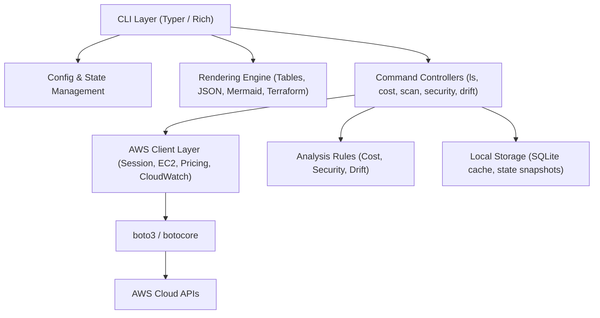

# Architecture Overview

`ec2kit` is built with a modular, layered architecture to guarantee isolation of concerns, testability, and security.

## High-Level Component Diagram

## Core Layers

1. **CLI Layer (`ec2kit.cli`)**:
   - Parses command-line inputs and handles global options.
   - Centralizes error handling and exit codes.
   - Enforces clean separation between `stdout` (data/JSON) and `stderr` (logs/diagnostics).

2. **AWS Interaction Layer (`ec2kit.aws`)**:
   - Wraps boto3 client creation and native credential chains.
   - Transparently handles retries, throttling, and pagination.
   - Isolates AWS API idiosyncrasies from domain logic.

3. **Domain & Analysis Layer (`ec2kit.analysis`)**:
   - Pure Python evaluation rules for cost right-sizing, idle resources, and security posture.
   - Never makes unauthorized network calls.

4. **Rendering Layer (`ec2kit.render`)**:
   - Transforms structured models into human-friendly Rich tables, machine-readable JSON, Mermaid architecture graphs, or Terraform manifests.

5. **Local Storage (`ec2kit.storage`)**:
   - SQLite cache located in user's XDG cache directory.
   - Stores pricing data and historical scan snapshots.
   - Never stores AWS credentials or access tokens.
